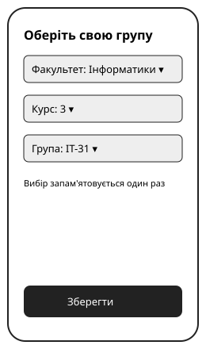
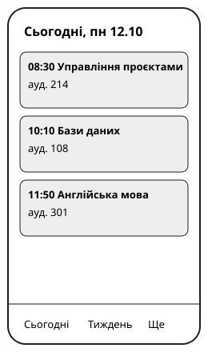
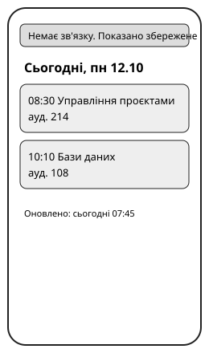
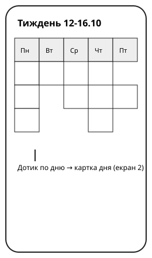
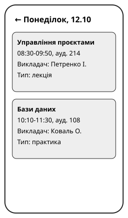

# Журнал спринта, ЛР3

Каркас для самостійної роботи ЛР3. Заповніть його у своєму репозиторії. Умова
роботи лежить у матеріалах курсу, `lr03_task.md`. Результат зараховується у
складі модуля M5.

| Поле | Значення |
| --- | --- |
| Студент і підгрупа | Мазурок Анна KN1 |
| Тема і файл стартового беклогу | Мобільний застосунок розкладу академії з сповіщеннями про зміни, `lr03_backlogs/schedule_app.csv` |
| Дати роботи | 12.10.2026 (дні 1-3 умовного спринта) |

## 1. Порядок беклогу і цінність

П'ять історій, які я поставила угору, і чому саме вони.

| story_id | Чому вгорі, словами замовника |
| :-: | --- |
| S-03 | Замовник хоче, щоб людина відкрила продукт і за один погляд отримала те, за чим прийшла. Студентові між парами потрібні саме пари на сьогодні з часом і аудиторією. |
| S-02 | Без обраної групи розклад не «свій»: один раз обрав і далі бачиш тільки потрібне, тобто знову з першого погляду. |
| S-04 | Тижнева сітка з переходом у картку дня: студент планує тиждень і бачить деталі пари. Це друга частина «за один погляд». |
| S-09 | Друга вимога замовника: дані оновлюються самі, бо руками їх ніхто щотижня переносити не буде. Це єдина історія, яка це забезпечує. |
| S-08 | Студент у корпусі зі слабким сигналом усе одно має отримати розклад за один погляд, тож збережена копія потрібна. |

## 2. Ціль спринта

Ціль одним реченням: Наприкінці спринта студент може обрати свою групу і з першого погляду побачити свої пари на сьогодні та на тиждень, а розклад підтягується з системи деканату автоматично.

Чому вона цінна для замовника: вона закриває обидві його вимоги: «за один погляд те, що потрібно» і «дані оновлюються самі».

Як перевірю, що досягнута: на телефоні обираю групу, бачу пари на сьогодні й тиждень, а зміна в системі деканату з'являється в застосунку без ручного перенесення. Відповідь одним словом: так або ні.

## 3. Оцінки і спринт-беклог

Ємність спринта 12 одиниць, не більше 4 на день.

| story_id | Оцінка | Узято в спринт | Причина, якщо не взято |
| :-: | :-: | :-: | --- |
| S-01 | 2 | ні | Вхід акаунтом академії не потрібен для цілі: групу можна обрати без входу. До того ж із ним сума була б 13. |
| S-02 | 2 | так | |
| S-03 | 2 | так | |
| S-04 | 2 | так | |
| S-05 | 1 | ні | Дешева, але ціль не рухає: розклад викладача не входить у першу вимогу замовника. |
| S-06 | 3 | ні | Велика, і спирається на дані з S-09. Робити сповіщення до автоматичного імпорту передчасно. |
| S-07 | 2 | ні | Налаштування сповіщень мають сенс тільки після самих сповіщень (S-06). |
| S-08 | 2 | так | |
| S-09 | 3 | так | |
| S-10 | 1 | ні | Дешева, але це зручність, а не ціль. |
| S-11 | 2 | ні | Ручна правка є запасним шляхом, ціль вимагає автоматичного. |
| S-12 | 1 | ні | Дешева, але оголошення не стосуються цілі. |
| S-13 | 2 | ні | Звіт потрібен після появи сповіщень, а їх у спринті немає. |

Сума оцінок узятого: 11 з 12 (S-02 2 + S-03 2 + S-04 2 + S-08 2 + S-09 3). Одну одиницю лишила в резерві.

## 4. День 1

Що закрила, з ескізами і рядком перевірки:

| story_id | Одиниць | Як користувач перевірить | Ескіз |
| :-: | :-: | --- | --- |
| S-02 | 2 | Студент обирає факультет, курс і групу один раз, закриває і знову відкриває застосунок, і група вже збережена. |  |
| S-03 | 2 | Студент відкриває застосунок і одразу бачить пари на сьогодні з часом і аудиторією. |  |

Закрито за день 1: 4 одиниці, обидві історії день 1.

План на день 2, записаний до відкриття конверта 1: S-09 (3 одиниці): запит на доступ до системи деканату і початок імпорту. Решту дня 1 одиницю не планую.

Що змінилось після конверта 1 і чому: S-09 залежить від чужої системи, відповідь прийде не раніше наступного тижня, тож закрити її в цьому спринті неможливо. Вона була в моєму спринті, тому ціль у частині «автоматично» під загрозою від самого початку. Я відправила запит у день 1 і позначила S-09 заблокованою. Її 3 одиниці звільнились, але спринт не переплановується, тому нову історію замість неї не беру. На день 2 переношу S-04 і S-08 (4 одиниці).

## 5. День 2

| story_id | Одиниць | Як користувач перевірить | Ескіз |
| :-: | :-: | --- | --- |
| S-08 | 2 | Студент вимикає інтернет і відкриває застосунок, і збережений розклад показано з позначкою «Немає зв'язку». |  |
| S-04 | 2 | Студент відкриває тижневу сітку і дотиком по дню переходить у картку цього дня. Позначена готовою у день 2, потім повернена після конверта 2. |  |

План на день 3, записаний до відкриття конверта 2: S-09 лишається заблокованою і одиниць не отримує. У день 3 прогоняю на телефоні S-02, S-03, S-04, S-08 і тримаю 1 одиницю резерву.

Що змінилось після конверта 2 і чому: у S-04 два різні режими перегляду і перехід між ними, тож справжня вартість на 2 одиниці більша за мою оцінку (4 замість 2). Історія була позначена готовою, тепер вона готова наполовину: показаний тільки тижневий режим, картки дня немає. Повертаю її в роботу на день 3. Ці 2 одиниці беру з тих 3, що звільнились від заблокованої S-09. Через це у спринт нічого не потрапило замість них, бо без S-09 день 3 був вільний.

Як могла помітити на плануванні: у формулюванні S-04 стоїть сполучник «і» («тижневою сіткою і відкривати картку дня»). Це ознака двох робіт в одній історії. Треба було розбити її на дві.

## 6. День 3 і рішення за конвертом 3

| story_id | Одиниць | Як користувач перевірить | Ескіз |
| :-: | :-: | --- | --- |
| S-04 | 2 | Студент відкриває тиждень і дотиком по дню бачить картку цього дня з часом, аудиторією і викладачем. Обидва режими показані. |  |

Рішення за конвертом 3 і його ціна: замовник просить на демо ще одну історію. Не беру. Найвидиміша з дешевих, S-10 (експорт у календар), не рухає ціль і потребує перевірки на реальному телефоні, а час після S-04 потрібен на перевірку готових історій. Ціна: замовник не побачить експорт у календар на демо, він піде в наступний спринт.

Що б я сказала замовнику вголос: «Експорт у календар покажу в наступному спринті. Цей спринт про групу, розклад на сьогодні й тиждень і офлайн. Якщо зараз додати ще одну історію, я не встигну належно перевірити ті, що вже є».

## 7. Огляд

Готові історії за означенням готовності: S-02 (день 1), S-03 (день 1), S-08 (день 2), S-04 (день 3, після повернення в роботу). Усі мають ескіз, рядок перевірки і день закриття. S-09 не готова: заблокована зовнішньою залежністю, одиниці не зараховуються. Закрито 8 одиниць за оцінками з 11 узятих.

Ціль спринта досягнута: ні

Якщо ні, то через що саме: ціль була мішком із двох окремих дій: «бачу розклад» і «розклад оновлюється автоматично». Перша виконана, друга залежала від S-09, яку неможливо було закрити через чужу систему. Треба було формулювати ціль тільки про те, що в моїх руках.

## 8. Блокери

| Коли | Що зупинило роботу | Чим закінчилось |
| :-: | --- | --- |
| Кінець дня 1 | S-09: відповідь від системи деканату не раніше наступного тижня | Не знято до кінця спринта. Історія перенесена в наступний спринт, її одиниці не зараховані. |
| День 2 | S-04 виявилась удвічі більшою за оцінку (два режими) | Знято в день 3 за рахунок звільнених одиниць S-09. |

## 9. Ретроспектива

Що допомагало: денна стеля 4 одиниці не дала набрати зайвого. Незайнятий резерв і звільнені одиниці S-09 дали змогу добудувати S-04.

Що заважало: у спринт узята історія із зовнішньою залежністю, і ціль залежала від неї. Оцінку S-04 поставила, не помітивши сполучника «і».

Одне рішення на наступний спринт: для кожної історії із зовнішньою залежністю відправляю запит у перший день планування і записую дату відправки та дату очікуваної відповіді. Якщо відповіді немає, історію не беру в points і не пишу її в ціль. Історії зі сполучником «і» в формулюванні розбиваю на дві до оцінювання.

Як перевірю, що це сталося: у `sprints.md` біля кожної такої історії є дві дати (запит і очікувана відповідь), у цілі спринта немає історій без відповіді, а в спринт-беклозі немає жодної історії зі сполучником «і» без розбиття.

## 10. Самодіагностика «Scrum, але»

Спотворення зі слайда 10 лекції L3, яке я знайшла у власному спринті: рядок «Sprint Goal». Задум за Scrum Guide це одна зв'язна ціль спринта, а типове спотворення це мішок незв'язаних тікетів «щоб усі були зайняті». У моєму спринті ціль склалась із двох окремих дій, а набір історій у розділі 3 тримався на «влізти в 12 одиниць», а не на одній дії користувача.

Ознака, за якою його видно в цьому журналі: у розділі 2 ціль має дві різні дії через «а» («обрати групу і побачити пари... а розклад підтягується автоматично»). Через це в розділі 7 на питання «ціль досягнута?» немає чистого «так»: виконана половина, і довелося писати «ні». Діагностичне питання зі слайда («що ми тут інспектуємо і що адаптуємо?») для другої половини цілі не мало відповіді: S-09 стояла заблокованою від кінця дня 1, тож інспектувати на огляді було нічого.